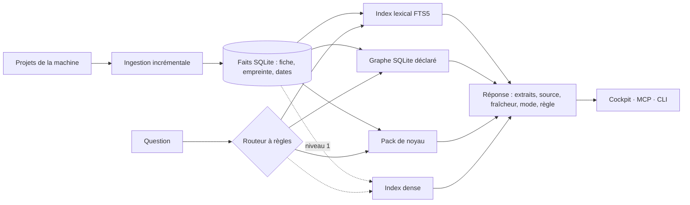

# Cadrage : le portail de connaissance local (EKP, RAG, CAG, KAG)

- **Statut** : accepté le 2026-10-23. Guilhem a retenu les treize
  recommandations du §8 ; E0 et E1 sont lancés.
- **Date** : 2026-10-23.
- **Base lue** : `origin/main` au commit `bb42966f8` (version 3.64.0). Chaque
  fichier cité au §3 a été relu à ce commit. `S/` abrège `src/grimoire/`.
- **Entrées** : une étude de l'état de l'art faite par recherche web, et un
  inventaire du code de la mémoire.
- **Ce que ce texte n'est pas** : il ne livre aucun code et ne mesure rien.
  Les chiffres du §9 sont ceux des sources, avec leur provenance. Ce qui n'a
  pas été mesuré est marqué comme tel.

## 1. Vision en une page

Grimoire fait des projets de ta machine un portail de connaissance local.
Tes dépôts, tes décisions, tes tâches, tes preuves et tes sessions répondent
à tes questions et à celles de tes agents. Chaque réponse donne sa source et
sa date. Tout reste sur ta machine, et tu choisis le modèle, local ou distant.

Le principe vient de l'Enterprise Knowledge Portal (EKP) : ingérer, cataloguer,
rechercher, relier et gouverner la connaissance. Il est ramené à l'échelle
d'une personne et de ses projets.

### Les questions que l'on peut poser

| Question | Portée | Ce que la réponse contient |
|---|---|---|
| « Pourquoi a-t-on choisi FTS5 plutôt que tantivy par défaut ? » | un projet | la décision, sa date, la tâche qui l'a prise, la preuve liée |
| « Où est défini `rrf_fuse`, et qu'est-ce qui l'appelle ? » | un projet | le fichier et la ligne, les appelants, la fraîcheur de l'index du code |
| « Qu'ai-je décidé sur la mémoire dans tous mes projets depuis septembre ? » | plusieurs projets | une liste étiquetée par projet, sans mélange de contenu |
| « Qu'est-ce qui est périmé dans ce que tu sais de ce projet ? » | un projet | les faits dont la source a changé ou disparu depuis l'indexation |
| « Quelles tâches et quelles preuves touchent ce module ? » | un projet | un chemin d'arêtes typées : tâche, preuve, verdict, fichier |
| « Que faut-il savoir avant de travailler ici ? » | un projet | le noyau du projet : conventions et décisions actives, dans un budget fixe |

### Ce que l'utilisateur vit

| Où | Ce qui se passe |
|---|---|
| Au démarrage d'une session | L'agent connaît déjà le noyau du projet. Personne n'a eu à poser de question. |
| Dans le cockpit, espace Mémoire | Un champ « Demander », en portée « Ce projet » ou « Tous les projets ». Chaque résultat porte un badge (à jour, périmé, non vérifié), une date et un lien vers sa source. |
| Dans l'agent (Claude Code, Copilot ou autre client MCP) | Un outil MCP qui rend des extraits sourcés. Le modèle de l'utilisateur rédige la réponse, il ne l'invente pas. |
| En ligne de commande | La même réponse, au format texte ou JSON. |

### Ce que le portail n'est pas

- **Pas un générateur de réponses.** Le kit rend des extraits sourcés, et le
  modèle de l'hôte rédige. Le kit n'appelle aucun modèle (voir la décision D2).
- **Pas un service.** Le niveau de base n'a ni serveur, ni réseau, ni modèle.
- **Pas un EKP multi-utilisateurs.** Il n'y a ni rôles ni annuaire. Les droits
  se réduisent à l'isolation par projet et à l'exclusion explicite d'un projet
  (§5.5).

### Le contrat de réponse, identique partout

Une réponse est une liste d'extraits. Chaque extrait porte son projet, sa
source, l'empreinte de la source, la date de la source, la date d'indexation
et sa fraîcheur. La réponse porte aussi le mode utilisé, la règle qui l'a
choisi, le niveau installé et les dégradations subies. Une réponse vide dit
pourquoi elle est vide (rien trouvé, index absent ou projet illisible) : une
lecture ratée ne vaut jamais « rien à dire ».

## 2. Modèle conceptuel

### 2.1 Les briques d'un EKP, transposées en local

| Brique | Rôle dans un EKP | Transposition locale |
|---|---|---|
| Ingestion | connecteurs, déduplication, source canonique | les projets de la machine : docs, code, ledger de tâches, preuves, décisions, faits de session ; incrémentale par empreinte |
| Catalogue | inventaire des objets avec leurs métadonnées | la fiche de fait (§5.1) : projet, type, source, empreinte, dates, cycle de vie |
| Recherche | plein texte, vecteurs, filtres | lexical BM25 (FTS5) partout ; dense en option ; filtres de projet, de type et de fraîcheur |
| Graphe | relations entre concepts | relations **déclarées** (dépendances de tâches, preuve vers tâche, remplacement, imports) ; les liens heuristiques sont marqués comme tels |
| Contexte préchargé | le « savoir de base » toujours présent | le noyau du projet, petit et stable, injecté au démarrage |
| Gouvernance : provenance | qui, quoi, quand, pour chaque résultat | source, empreinte et producteur sur chaque fait |
| Gouvernance : fraîcheur | détection du périmé | comparaison de l'empreinte à la lecture ; paliers d'âge quand il n'y a pas de source à relire |
| Gouvernance : droits | filtrage selon les permissions | isolation par projet ; exclusion d'un projet de la recherche croisée |
| Gouvernance : oubli | expiration, archivage | source disparue retirée ; fait remplacé non servi ; suppression explicite |

### 2.2 Trois modes de réponse

| Mode | Sert à | Taille de la base | Coût local | Forme dans le kit |
|---|---|---|---|---|
| **CAG** (contexte préchargé) | le noyau stable : conventions, décisions actives, contexte du projet | petite, bornée par un budget | nul à l'indexation ; un préfixe à chaque session | pack de noyau déterministe, injecté au démarrage. Le cache de préfixe du fournisseur est un bonus, pas une promesse |
| **RAG** (récupération) | le volume : docs, code, historique | quelconque | lexical : quasi nul ; dense : un embedding par extrait | FTS5 BM25 ; plus dense et fusion RRF au niveau 1 |
| **KAG** (graphe) | les relations : impact, « qui dépend de », « pourquoi » | quelconque | nul tant que les arêtes viennent des structures déclarées | tables SQLite de nœuds et d'arêtes, traversée à un ou deux sauts. Chaque nœud pointe vers ses extraits, et chaque extrait vers ses nœuds (indexation mutuelle, reprise de KAG) |

Le CAG au sens du papier (KV-cache) n'est portable ni vers tous les modèles ni
vers tous les fournisseurs. La version portable, c'est le pack de noyau : un
texte stable placé en tête de contexte, que le fournisseur met en cache ou non.

### 2.3 Un routeur de mode déterministe d'abord

Le routeur est une table de règles évaluées dans l'ordre. Il n'utilise pas de
modèle. Une même question sur une même base donne toujours le même mode, et
la réponse nomme la règle appliquée.

| Ordre | Si la question… | Mode | Exemple |
|---|---|---|---|
| 1 | contient un identifiant, un chemin, un nom de symbole ou un texte entre guillemets | RAG lexical (trigramme pour les identifiants) | « où est `rrf_fuse` » |
| 2 | demande une relation (« qui dépend de », « impact », « lié à », « quelle tâche a touché », « pourquoi a-t-on ») | KAG, puis RAG lexical sur les nœuds trouvés | « quelles preuves touchent ce module » |
| 3 | porte sur le cadre du projet (« conventions », « avant de travailler », « comment on fait ici »), et le noyau tient dans le budget | CAG | « que faut-il savoir ici » |
| 4 | demande ce qui a changé ou ce qui est périmé | lecture de la fraîcheur, sans recherche | « qu'est-ce qui est périmé » |
| 5 | sinon | RAG : hybride si le dense est installé, lexical sinon | « comment marche la mémoire transverse » |

Les règles sont testées comme une table (question, mode attendu). Aucune source
publiée ne compare un routeur à règles à un classifieur appris (Adaptive-RAG,
Self-Route). Le routeur se juge donc sur le jeu de questions local (§6). Un
classifieur ne remplacera les règles que s'il les bat sur ce jeu (voir D9).

## 3. Existant et cible

Légende : **présent** (branché en production), **partiel** (existe mais
incomplet ou non branché), **absent**, **mort** (aucun appelant en production :
à retirer ou à brancher).

| Brique | État | Fichiers sur main | Cible |
|---|---|---|---|
| Index lexical FTS5 BM25, sans dépendance | présent | `S/memory/backends/lexical.py:55,79` ; choisi par `auto` sans URL : `S/memory/manager.py:89-107` | reste le socle du niveau 0 ; trigramme ajouté pour les identifiants |
| Fusion RRF (k = 60) et tolérance de panne | présent | `S/memory/retrieval.py:19,35` ; `S/memory/manager.py:660` | inchangé ; sans backend dense, la fusion n'a qu'un classement (`manager.py:670`), donc l'afficher comme « lexical seul » |
| Vectoriel (Qdrant, Weaviate, Ollama, fastembed) | partiel | extras ; modèle par défaut anglais `S/memory/embedding.py:34` | niveau 1, choisi sur le jeu local (D3, D4) |
| Profil `standard` | partiel | annonce « Sémantique + BM25 fusionnés (RRF) » : `S/memory/profiles.py:186` ; reste lexical sans extra ni URL | libellé honnête : affiche ce qui tourne réellement (lot E1) |
| Ingestion des docs | partiel | une entrée par page, tronquée à 8 000 caractères : `S/memory/projections.py:876` | découpage par section, incrémental par empreinte (E2) |
| Ingestion du code | partiel | AST Python seulement : `S/codegraph/parser.py:112` | inchangé dans ce cadrage ; d'autres langages hors périmètre |
| Ingestion du ledger | présent | seule écriture mémoire à la clôture, au blocage ou à l'échec : `S/missions/service.py:1166` | source de nœuds et d'arêtes du graphe (E5) |
| Faits temporels (`valid_from`) | partiel | `S/memory/sidecar.py:27,34` ; CLI seulement : `S/cli/cmd_memory.py:1208` | lus par le graphe et par l'API (E5) |
| Mémoire transverse | présent | paliers de 90 et 270 jours : `S/memory/shared.py:51-52` | modèle de fraîcheur réutilisé pour les faits sans source (E1) |
| Agrégation multi-projets (#172) | présent (lecture) | `S/tools/workspace_memory.py:164,214` ; routes `S/tools/workspace_routes.py:235,295` | même chaîne pour « Demander » ; exclusion par projet (E7) |
| Serveur MCP mémoire | partiel | deux outils seulement : `S/mcp/server.py:347,375` | un outil de question unique (E6) ; le graphe et la fraîcheur derrière lui |
| Contexte injecté au démarrage | présent | `S/hosts/decisions/activation.py:337` ; rappel de la tâche réclamée `:132` | reçoit une ligne « noyau du projet » (E4) |
| Rappel borné par tâche | présent | 400 tokens par défaut : `S/missions/recall.py:58` | inchangé |
| Capsule `context-pack` | mort | manifeste de 6 fichiers sans contenu : `S/tools/context_pack.py:60,117-119` ; écrit, jamais relu | devient le pack de noyau, avec contenu, lecteur et invalidation (E4, D8) |
| `MemoryManager.progressive_search` | mort | `S/memory/manager.py:1253` ; aucun appelant ni test ; décrite dans le manuel (`explications/memoire.md`) | à retirer, ainsi que sa section du manuel (E0) |
| `RedisHotMemory` | mort | `S/memory/hot.py:31` ; seule `health_check` est appelée (`manager.py:913`) ; le profil `complet` promet « TTL, baux, coordination multi-agents » | retirer ou brancher (D6) |
| `MemoryManager.supersede` | partiel | `S/memory/manager.py:806` ; appelée par les tests seulement ; le filtre de lecture, lui, est actif (`manager.py:632-635`) | geste de remplacement exposé en CLI et MCP (E1) |
| `CodeGraph.impact_query`, `hotspots` | mort | `S/codegraph/graph.py:93,111` ; aucun appelant en production | branchés derrière la règle 2 du routeur (E5) |
| `Neo4jCodeGraphBackend` | mort | `S/codegraph/backends/neo4j.py:91,124` : écrit le graphe et porte une requête d'impact Cypher, sans aucun appelant | même contrat de requête que le graphe SQLite, au niveau 2 seulement (D7) |
| Projection Neo4j de la mémoire | partiel | `S/memory/neo4j_graph.py` : `upsert_*`, `stats`, purge, pas de méthode de lecture | miroir optionnel ; la lecture de référence est le graphe SQLite (D7) |
| Champs `provenance`, `freshness`, `task_ref` | partiel | déclarés mais non alimentés : `S/memory/backends/base.py:28-30` (`freshness` vaut `"current"` par défaut, sans calcul) | alimentés à l'écriture et recalculés à la lecture (E1) |
| Fraîcheur du code | présent | `S/codegraph/freshness.py:159,219` (`current`, `stale`, `unverified`) | modèle repris pour toutes les sources fichier (E1) |
| Supersession mesurée | présent | `bench_supersession` : `S/memory/supersession.py:147` | rejoint les mesures déterministes (E3) |
| Dédoublonnage | partiel | exact seulement ; ne fait rien sur Qdrant (`S/memory/backends/_qdrant_mixin.py:152`), Weaviate et MemPalace | dédoublonnage par empreinte à l'ingestion, quel que soit le backend (E2) |
| Oubli et expiration | absent | la demi-vie de la stigmergie (`S/tools/stigmergy.py:51,78`) ne touche pas la mémoire | oubli mécanique sur source disparue ; paliers d'âge (§5.4) |
| Droits de lecture | absent | `user_id` sert de filtre, pas de contrôle | exclusion par projet (E7) ; pas de rôles |
| Évaluation de la récupération | partiel | `tests/unit/memory/test_retrieval_quality.py:128` : la fusion y est testée avec un faux vecteur | jeu de questions généré et mesures déterministes (E3) |
| Pile RAG héritée | mort | `framework/tools/rag-indexer.py`, `rag-retriever.py`, `memory-sync.py`, zone gelée ; aucune référence depuis `src/` | à retirer quand E2 couvre l'indexation incrémentale (E8, D10) |
| `ContextRouter`, `ContextGuard` | mort | orphelins tolérés par `tests/unit/test_w1_11_wire_or_delete.py:28` | hors périmètre ; le routeur de §2.3 ne les réutilise pas |

Écarts relevés par rapport à l'inventaire d'entrée :

- L'inventaire dit que rien n'interroge Neo4j. En fait,
  `Neo4jCodeGraphBackend.query_impact` porte une requête Cypher de lecture,
  mais aucun code ne l'appelle. La conclusion pratique reste la même : aucune
  lecture de graphe n'est atteignable depuis un agent.
- Les numéros de ligne de `profiles.py` ont bougé : `DEFAULT_PROFILE` est à la
  ligne 233.

## 4. Architecture cible à trois niveaux

### 4.1 Les niveaux

| Niveau | Installation | Moteurs | Ce qu'il apporte | Profil existant |
|---|---|---|---|---|
| **0, zéro dépendance** | `pip install grimoire-kit` | fichiers, SQLite FTS5, graphe SQLite (tables de nœuds et d'arêtes, requêtes récursives), pack de noyau | les trois modes, sans modèle ni réseau ; toute la gouvernance | `lexical` |
| **1, léger CPU** | un extra d'embeddings (fastembed, ONNX CPU, bundle air-gap déjà livré) | niveau 0 plus un index dense local et la fusion RRF ; reranking optionnel | meilleur rappel sur les paraphrases et le vocabulaire différent | `standard`, quand le dense est vraiment là |
| **2, complet** | services au choix : Qdrant serveur, Neo4j, un modèle d'extraction local ou distant | niveau 1 plus un graphe serveur, et en option une extraction d'entités par modèle, avec devis préalable | échelle, visualisation du graphe, relations non déclarées | `graphe`, `complet` |

### 4.2 Ce qui ne change jamais

| Invariant | Pourquoi |
|---|---|
| La fiche de fait (§5.1), versionnée | un fait indexé au niveau 2 se relit au niveau 0 |
| Provenance et fraîcheur sur chaque extrait | ce sont des données structurées, qui ne dépendent d'aucun modèle |
| L'API : un outil MCP et une commande CLI, même entrée, même forme de sortie | l'hôte et l'utilisateur ne savent pas quel niveau répond, sauf en le lisant dans la réponse |
| Le routeur à règles et sa table | même question, même mode, à tous les niveaux |
| La règle « inconnu ≠ vrai » (§5.3) | une fraîcheur non vérifiée n'est jamais affichée « à jour » |
| Le niveau 0 comme repli | si un moteur du niveau 1 ou 2 tombe, la réponse vient du niveau 0 et le dit (`dégradations`) |

### 4.3 Ce qui change d'un niveau à l'autre

| Axe | Niveau 0 | Niveau 1 | Niveau 2 |
|---|---|---|---|
| Rappel sur les paraphrases | faible (lexical) | meilleur, à mesurer sur le jeu local | idem, plus reranking |
| Relations | déclarées seulement | déclarées seulement | déclarées, plus extraites par modèle, marquées `extraite` |
| Échelle | un projet ou une flotte de taille personnelle | idem | au-delà, avec des services |
| Coût d'indexation | lecture et hachage des fichiers | plus un embedding par extrait | plus un appel de modèle par extrait si l'extraction est activée, toujours précédé d'un devis |
| Dépendance au modèle d'embedding | aucune | l'index est lié au modèle, consigné dans un manifeste d'index ; un index incompatible est refusé | idem |

Aucun de ces écarts de qualité n'est mesuré à ce jour. Le §6 dit comment les
mesurer sans banc payant.

## 5. Gouvernance de la connaissance

### 5.1 La fiche de fait

| Champ | Sens | Aujourd'hui |
|---|---|---|
| `id` | identifiant stable | présent |
| `projet` | projet d'origine | `project_name` en métadonnée, posé par le manager |
| `type` | décision, échec, convention, doc, code, tâche, preuve, fait | les 5 types protocole et les projections |
| `source.kind`, `source.uri` | fichier et ligne, commit, tâche, session, saisie libre | `source_kind` en métadonnée ; chemin pour les projections |
| `source.empreinte` | sha256 du contenu source au moment de l'indexation | code seulement (reçu du code graph) |
| `date_source`, `date_indexation`, `date_confirmation` | quand c'était vrai, quand on l'a lu, quand on l'a revu | date d'écriture seulement ; confirmation pour le transverse |
| `fraîcheur` | calculée à la lecture (§5.2), jamais stockée comme vérité | champ présent mais figé à `"current"` |
| `cycle` | `actif`, `remplacé` (avec `remplacé_par`), `retiré` | `superseded_by` filtré à la lecture |
| `producteur` | humain, agent, projection, extraction par modèle | partiel (`source_kind`) |
| `lien` | `déclaré`, `heuristique` ou `extrait`, pour toute arête | absent ; les liens tâche vers code sont heuristiques sans le dire |

### 5.2 La fraîcheur, calculée à la lecture

| État | Condition | Affichage |
|---|---|---|
| `à jour` | la source se relit et son empreinte égale celle de l'indexation | badge neutre |
| `périmé` | la source se relit mais son empreinte a changé | badge d'alerte, avec la date du changement |
| `source disparue` | la source ne se relit plus (fichier supprimé, commit absent) | non servi par défaut, listé dans « ce qui est périmé » |
| `non vérifié` | pas de source à relire (saisie libre, décision orale) et dernière confirmation de 90 jours au plus | badge « non vérifié », avec l'âge |
| `hypothèse` | pas de source à relire et dernière confirmation de plus de 270 jours | servi en dernier, marqué hypothèse |

Les paliers de 90 et 270 jours sont repris de la mémoire transverse
(`S/memory/shared.py:51-52`). D11 décide s'ils s'appliquent tels quels à la
mémoire projet.

### 5.3 Inconnu ≠ vrai

- Un fait sans source à relire n'est jamais `à jour`. Au mieux, il est
  `non vérifié`.
- Un index absent, un projet illisible ou un moteur en panne apparaît dans la
  réponse. Il ne compte pas comme « aucun résultat ».
- Un lien heuristique n'est jamais présenté comme une relation déclarée.
- Un mode non disponible (dense absent, graphe non construit) est signalé dans
  `dégradations`. Il n'est pas remplacé en silence.
- Un chiffre de qualité sans mesure n'apparaît nulle part. Un taux calculé sur
  zéro résultat vaut « inconnu », pas zéro, comme le fait déjà
  `bench_supersession`.

### 5.4 Oubli et périmé

| Événement | Effet |
|---|---|
| La source d'un extrait est supprimée | à la synchronisation suivante, l'extrait passe `retiré` et n'est plus servi ; il reste listé dans la synchronisation |
| La source change | l'extrait passe `périmé` à la lecture ; la synchronisation le remplace (nouvel extrait, ancien `remplacé`) |
| Un humain ou un agent remplace une décision | geste explicite `remplacer` ; l'ancienne n'est plus servie mais reste lisible avec `include_superseded` |
| Une décision vieillit sans être revue | déclassement par paliers, sans suppression |
| L'utilisateur demande l'oubli | suppression explicite (la commande `memory delete` existe) ; le graphe et le pack de noyau suivent à la reconstruction |

Il n'y a pas de durée de vie automatique sur la mémoire projet (D11). Ce qui
est vieux reste lisible, simplement déclassé.

### 5.5 Plusieurs projets, et leurs frontières (issue #172)

L'issue #172 est close. La lecture croisée est sur main : les chemins viennent
du registre de la machine, aucune écriture n'a lieu, chaque résultat est
étiqueté par projet et aucun contenu n'est fusionné
(`S/tools/workspace_memory.py:1-30`). Le cadrage garde ces refus et ajoute
trois frontières :

| Frontière | Règle |
|---|---|
| Exclusion d'un projet | un projet marqué `confidentiel` dans sa configuration n'est lu ni par la recherche croisée, ni par le pack de noyau d'un autre projet, ni par la promotion transverse |
| Pas de fusion | une réponse multi-projets reste une liste étiquetée ; un extrait ne cite jamais un autre projet que le sien |
| Projet illisible | listé avec sa raison, jamais compté comme vide (comportement actuel, gardé) |

Un seul utilisateur et une seule machine : il n'y a pas de rôles. La mémoire
transverse garde son magasin physiquement séparé et sa promotion filtrée
(`S/memory/shared.py`).

## 6. Évaluer sans banc payant

Depuis le 2026-10-20, aucun banc payant ne se lance sans demande explicite.
Ici, tout est déterministe : aucun modèle juge, aucun appel payant, aucune
charge de modèle local.

| Mesure | Définition | Source de vérité |
|---|---|---|
| Couverture | part des fichiers éligibles effectivement indexés ; extraits orphelins | manifeste d'ingestion et système de fichiers |
| Attribution | part des extraits servis dont la source se relit et dont l'empreinte se vérifie | fiche de fait |
| Fraîcheur servie | part des extraits servis `périmé` ou `source disparue` présentés comme `à jour` (cible : aucun) | calcul de fraîcheur |
| Remplacés servis | `stale_served_as_fact_rate`, déjà mesuré par `bench_supersession` | `S/memory/supersession.py:147` |
| Rappel | Recall@k et MRR par mode (lexical, dense, hybride, graphe) sur le jeu généré | jeu de questions |
| Routeur | concordance de la table (question, mode attendu) | table de tests |
| Coût du noyau | taille estimée du pack (caractères ÷ 4, estimation déclarée) contre le budget | pack de noyau |

### 6.1 Le jeu de questions généré depuis la base

1. Échantillonner des extraits avec une graine fixe.
2. Produire les questions par gabarit, depuis la structure : un titre de
   section donne « que dit-on de X ? », un symbole ou un identifiant donne
   « où est défini X ? », une décision donne « pourquoi X ? », et une
   arête déclarée donne « qu'est-ce qui relie X à Y ? ».
3. Prendre l'extrait d'origine, ou l'arête, comme réponse attendue.
4. Mesurer chaque mode sur le même jeu.

Les limites sont déclarées avec chaque résultat :

- Biais lexical : la question reprend les mots de l'extrait, ce qui favorise
  le lexical.
- Pas de multi-saut, hors questions d'arête.
- Le score sert d'indicateur de régression, pas de mesure absolue.

Une variante optionnelle ajoute des paraphrases avec le modèle que
l'utilisateur a déjà. Elle est opt-in et hors CI.

### 6.2 Où cela tourne

| Lieu | Corpus | Rôle |
|---|---|---|
| CI du kit | un corpus figé dans les tests (docs, code, ledger, décisions) | non-régression de chaque lot |
| Machine de l'utilisateur | son projet, à la demande (extension de `memory bench`) | décider si le niveau 1 vaut son coût sur ses données |

## 7. Découpage en lots

L'effort compte en PR revues : **S** pour une PR, **M** pour deux ou trois,
**L** pour quatre ou plus. Chaque lot livre quelque chose qu'un utilisateur du
kit reçoit.

| Lot | Valeur pour l'utilisateur | Effort | Dépend de |
|---|---|---|---|
| E0 | moins de surface fausse : le manuel ne décrit plus une fonction que rien n'appelle | S | rien |
| E1 | chaque résultat de mémoire dit d'où il vient, de quand il date et s'il est encore vrai ; visible dans le cockpit et dans l'agent | M | rien |
| E2 | les longues docs sont trouvées en entier ; la resynchronisation ne réécrit que ce qui a changé ; ce qui a disparu n'est plus servi | M | E1 |
| E3 | la qualité de la recherche se mesure sans banc payant, sur le kit et sur son propre projet | M | E2 |
| E4 | chaque session démarre en connaissant le noyau du projet | M | E1 |
| E5 | « qu'est-ce qui touche ce module » et « pourquoi » répondent par des liens typés | L | E1, E2 |
| E6 | une seule question, le bon mode choisi et expliqué, partout (cockpit, MCP, CLI) | M | E3, E4, E5 |
| E7 | demander sur tous ses projets, avec des projets exclus et respectés | S | E6 |
| E8 | une seule pile RAG au lieu de deux | M | E2 |
| E9 | le dense local devient utile par défaut quand il est installé, si la mesure le justifie | M | E3, D3, D4, D5 |

### Détail des lots

Chaque critère d'acceptation se vérifie par un test ou une commande. Pour un
critère de comportement, le test est rouge avant le lot et vert après.

**E0 : retrait préalable.**

- Périmètre : retirer `MemoryManager.progressive_search` et la section
  « Progressive search » de `explications/memoire.md`. Redis et la pile
  héritée se décident à part (D6, D10).
- Acceptation : aucune occurrence hors `CHANGELOG.md` ; suites vertes ;
  le cliquet de lignes baisse.

**E1 : provenance et fraîcheur visibles.** C'est le premier lot, petit et
visible.

- Périmètre :
  - poser `provenance` (projet, type de source, chemin, empreinte) à
    l'écriture ;
  - calculer la fraîcheur à la lecture dans `hybrid_search` (§5.2) ;
  - exposer ces champs dans `grimoire_memory_search`, dans
    `memory search` et dans l'espace Mémoire du cockpit (badge, date,
    lien vers la source) ;
  - exposer en CLI et en MCP le geste « remplacer » (`supersede`, qui
    existe déjà) ;
  - afficher le profil réellement en service.
- Acceptation :
  - une doc modifiée après sa synchronisation sort `périmé` ;
  - une saisie libre n'est jamais `à jour` ;
  - aucun résultat sans `source`, sauf `source: inconnue` explicite ;
  - une décision remplacée n'est plus servie mais reste lisible avec
    `include_superseded` ;
  - la capture du cockpit est validée par Guilhem.

**E2 : ingestion par extraits, incrémentale.**

- Périmètre :
  - découper les `.md` par section, l'identifiant de section faisant partie
    de la source ;
  - tenir un manifeste d'ingestion (source, empreinte, extraits) ;
  - à la synchronisation, ajouter le nouveau, remplacer le modifié et retirer
    le disparu ;
  - dédoublonner par empreinte, quel que soit le backend ;
  - ajouter le tokenizer trigramme pour les identifiants.
- Acceptation :
  - une doc de 20 000 caractères est couverte en entier ;
  - une resynchronisation sans changement n'écrit rien ;
  - un fichier supprimé n'est plus servi ;
  - la couverture est rapportée.

**E3 : évaluation déterministe.**

- Périmètre : le générateur de questions à graine fixe, les mesures du §6,
  un corpus figé en CI et l'extension de `memory bench`.
- Acceptation :
  - deux exécutions donnent le même rapport, octet pour octet ;
  - une mesure sans résultat vaut `null` ;
  - les limites sont écrites dans le rapport ;
  - un test avec sockets bloqués prouve qu'aucun appel réseau n'a lieu.

**E4 : noyau préchargé (CAG portable).**

- Périmètre :
  - un pack avec contenu : décisions actives, conventions, contexte du
    projet ;
  - un tri stable et un budget ;
  - l'empreinte des sources, qui sert à l'invalidation ;
  - une ligne best-effort au SessionStart (`activation.py`) et une lecture
    par MCP ;
  - le pack remplace le manifeste `context-pack` (D8).
- Acceptation :
  - mêmes sources, mêmes octets (compatible avec un cache de préfixe) ;
  - le pack ne dépasse pas le budget ;
  - une décision changée donne une nouvelle empreinte, et la session suivante
    le signale ;
  - un pack absent produit la ligne « noyau non construit », jamais un
    silence.

**E5 : graphe déclaré (KAG léger).**

- Périmètre :
  - des tables SQLite de nœuds et d'arêtes, alimentées par :
    - le ledger : types de dépendance `S/missions/schemas.py:126-131`, preuve
      vers tâche, verdict vers preuve ;
    - la supersession ;
    - le code graph : imports, `TESTED_BY` ;
    - les faits temporels ;
    - les liens Markdown ;
  - l'indexation mutuelle avec les extraits ;
  - les requêtes de voisinage, de chemin et d'impact (`impact_query`
    branchée) ;
  - les liens heuristiques marqués comme tels.
- Acceptation :
  - « quelles preuves et quelles décisions touchent X » rend un chemin
    d'arêtes typées et sourcées ;
  - aucune arête heuristique n'est servie comme déclarée ;
  - zéro service ;
  - la fraîcheur du graphe est rapportée.

**E6 : routeur et question unique.**

- Périmètre : le routeur de §2.3, un outil MCP et une commande CLI au contrat
  du §1, et le champ « Demander » du cockpit.
- Acceptation :
  - la table de routage passe en entier ;
  - chaque réponse nomme son mode, sa règle, son niveau et ses dégradations ;
  - un moteur absent fait retomber au niveau 0, avec la mention ;
  - la CLI, le MCP et le cockpit donnent les mêmes résultats sur le corpus
    de test.

**E7 : multi-projets avec frontières.**

- Périmètre : la portée « Tous les projets », par `workspace_memory`, et le
  marqueur `confidentiel`, honoré par la recherche, le pack de noyau et la
  promotion transverse.
- Acceptation :
  - un projet confidentiel n'apparaît dans aucun résultat croisé (test e2e) ;
  - aucun extrait ne mêle deux projets ;
  - un projet illisible est listé avec sa raison.

**E8 : retrait de la pile RAG héritée.**

- Périmètre : `framework/tools/rag-indexer.py`, `rag-retriever.py`,
  `memory-sync.py`, avec leurs tests et leurs références, une fois que E2
  couvre l'indexation incrémentale.
- Acceptation : `test_no_dangling_tool_refs` passe ; le cliquet de
  `framework/` baisse ; aucune commande documentée ne disparaît sans
  remplaçant.

**E9 : niveau 1 par défaut quand il est installé.**

- Périmètre :
  - `auto` choisit le dense local, avec son compagnon BM25, quand l'extra et
    son modèle sont disponibles hors ligne ;
  - un manifeste d'index (modèle, dimension, empreinte de configuration)
    refuse un index incompatible.
- Acceptation :
  - sur le corpus du kit, l'hybride égale ou dépasse le lexical en Recall@k
    (E3), sinon le lot s'arrête ;
  - aucun téléchargement implicite ;
  - un changement de modèle impose une réindexation annoncée.

Hors plan : l'extraction d'entités par modèle, les résumés de communautés
(GraphRAG) et Contextual Retrieval. Ils ne viendront qu'au niveau 2, en opt-in,
avec un devis affiché avant toute indexation qui appelle un modèle.

## 8. Décisions

Tranchées le 2026-10-23 : chaque décision suit sa recommandation.

1. **D1 : la surface.**
   - Options : (a) étendre « La mémoire du projet », avec `memory ask` et
     un outil MCP `grimoire_memory_ask` ; (b) créer un nouvel outil
     « Savoir » à côté des cinq.
   - Recommandation : **(a)**. Le kit se vend par cinq outils lisibles ; le
     portail est ce que la mémoire devient, pas un sixième nom.
2. **D2 : le kit génère-t-il les réponses ?**
   - Options : (a) jamais : il rend des extraits sourcés et le modèle de
     l'hôte rédige ; (b) en option, par le fournisseur configuré ; (c) par
     défaut.
   - Recommandation : **(a)** pour E0 à E9. Cela tient « n'importe quel
     LLM » sans coût. (b) pourra venir plus tard, en opt-in avec devis.
3. **D3 : le moteur dense du niveau 1.**
   - Options : (a) `qdrant-local`, existant et couvert par le bundle air-gap ;
     (b) sqlite-vec, dans le même fichier SQLite, encore pre-v1 ;
     (c) LanceDB.
   - Recommandation : **(a)** maintenant. (b) ne sera essayé qu'après E3 :
     un seul fichier est attrayant, mais une dépendance pre-v1 sans gain
     mesuré contredit la doctrine.
4. **D4 : le modèle d'embedding par défaut.**
   - Options : (a) garder `all-MiniLM-L6-v2`, anglais ; (b) un petit modèle
     multilingue ; (c) BGE-M3, multilingue et plus lourd.
   - Recommandation : **ne rien changer avant E3**, puis choisir sur le
     corpus français du kit. MTEB ne tranche pas pour un corpus de code et de
     notes en français.
5. **D5 : `auto` et le dense local.**
   - Options : (a) le dense reste explicite, comme aujourd'hui ; (b) `auto`
     le choisit dès qu'il est installé hors ligne (E9).
   - Recommandation : **(b), seulement si E3 montre un gain**. Dans tous les
     cas, le libellé du profil `standard` doit cesser d'annoncer une fusion
     qui n'a pas lieu (E1).
6. **D6 : Redis (mémoire chaude).**
   - Options : (a) retirer `RedisHotMemory`, l'extra et la promesse du
     profil `complet` ; (b) le brancher, par exemple comme cache du pack de
     noyau ; (c) laisser en l'état.
   - Recommandation : **(a)**, dans un lot à part, parce que le portail n'en
     a pas besoin. Il faut aussi mettre à jour le contrôle
     `memory.hot_degradation_undeclared` ajouté récemment.
7. **D7 : Neo4j.**
   - Options : (a) le graphe SQLite est la référence à tous les niveaux, et
     Neo4j reste un miroir optionnel ; (b) Neo4j devient le graphe interrogé
     au niveau 2, avec le même contrat de requête et un test de parité ;
     (c) retirer la projection.
   - Recommandation : **(a) maintenant, (b) seulement sur demande
     d'échelle**. La parité se teste alors sur les mêmes fixtures, comme pour
     le port Rust.
8. **D8 : `context-pack`.**
   - Options : (a) faire évoluer la commande en place (contenu, lecteur,
     invalidation, format versionné) ; (b) la retirer et créer le pack de
     noyau à côté.
   - Recommandation : **(a)**. Le nom existe déjà et rien ne lit l'ancien
     format.
9. **D9 : le routeur.**
   - Options : (a) des règles seulement ; (b) des règles, puis un
     classifieur léger s'il bat les règles sur le jeu local.
   - Recommandation : **(a)**. (b) reste ouvert, avec la barre suivante :
     battre les règles sur E3. Le gain publié de la sélection par requête
     est faible (§9).
10. **D10 : la pile RAG héritée de `framework/tools/`.**
    - Options : (a) la retirer après E2 ; (b) la garder gelée.
    - Recommandation : **(a)**. Deux piles RAG trompent sur ce que fait le
      kit.
11. **D11 : l'oubli dans la mémoire projet.**
    - Options : (a) aucune durée de vie, un déclassement par paliers d'âge
      (90 et 270 jours, repris du transverse) ; (b) une durée de vie par
      type.
    - Recommandation : **(a)**. On supprime quand la source disparaît ou sur
      geste explicite ; une décision ancienne reste utile à qui sait qu'elle
      est ancienne.
12. **D12 : la frontière multi-projets par défaut.**
    - Options : (a) ouverte, comme aujourd'hui (tous les projets du
      registre, en lecture étiquetée), avec une exclusion `confidentiel` ;
      (b) fermée, avec un opt-in par projet.
    - Recommandation : **(a)**. Même utilisateur, même machine, et le
      comportement actuel ne change pas ; l'exclusion couvre le cas sensible.
13. **D13 : le format d'échange.**
    - Options : (a) versionner la fiche de fait (`grimoire.knowledge.fact/v1`)
      et garder l'export JSON actuel ; (b) adopter OKF tout de suite.
    - Recommandation : **(a)**. Un export OKF pourra se brancher sur la fiche
      plus tard, sans bloquer le portail.

## 9. Sources

Étiquettes :

- **publié** : papier ou documentation, souvent lus sur le seul résumé ;
- **indépendant** : mesure faite par des tiers ;
- **éditeur** : affirmation d'un éditeur ou des auteurs sur leur propre
  système, sans réplication trouvée.

Aucun de ces chiffres n'est une performance attendue du kit.

### 9.1 Mesuré ou publié

| Source | Ce qu'on en retient | Statut |
|---|---|---|
| BEIR, <https://arxiv.org/abs/2104.08663> | BM25 est une baseline robuste ; le reranking est meilleur en moyenne, à coût élevé | publié |
| MTEB, <https://arxiv.org/abs/2210.07316> | aucune méthode d'embedding ne domine partout : il faut un jeu local | publié |
| RAG vs GraphRAG, <https://arxiv.org/abs/2502.11371> | indexation du graphe 41 à 57 fois plus longue que le RAG (avec un modèle distant) ; le RAG gagne sur les questions à un saut, le graphe sur le multi-saut, à 1 à 3 points de F1 ; sélection par requête +1,1 %, intégration +6,4 % sur un seul jeu | indépendant |
| GraphRAG-Bench, <https://arxiv.org/abs/2506.05690> | GraphRAG fait souvent moins bien que le RAG simple sur des tâches réelles | publié (résumé seul) |
| Lost in the Middle, <https://arxiv.org/abs/2307.03172> | la précision baisse quand l'information utile est au milieu d'un long contexte : le noyau doit rester petit | publié |
| RAG vs contexte long, <https://arxiv.org/abs/2407.16833> | le contexte long gagne en moyenne quand les ressources suffisent, le RAG coûte bien moins | publié |
| CAG, <https://arxiv.org/abs/2412.15605> | précharger une base petite et stable supprime l'étape de récupération ; la limite est la taille | publié (résumé seul, sans chiffre) |
| KAG, <https://arxiv.org/abs/2409.13731> | indexation mutuelle entre graphe et extraits ; +19,6 % et +33,5 % de F1 relatif | chiffres publiés par les auteurs |
| HippoRAG, <https://arxiv.org/abs/2405.14831> | graphe et PageRank personnalisé ; jusqu'à +20 % en multi-saut | publié par les auteurs |
| SQLite FTS5, <https://www.sqlite.org/fts5.html> | BM25 intégré, tokenizers `unicode61` et `trigram` | documentation |
| bge-small-en-v1.5, <https://huggingface.co/BAAI/bge-small-en-v1.5> | 33,4 M de paramètres, 384 dimensions, anglais seulement | publié par l'auteur du modèle |
| RAGAS, <https://arxiv.org/abs/2309.15217> ; RAGChecker, <https://arxiv.org/abs/2408.08067> | cadres d'évaluation, mais à juge LLM : écartés par défaut ici | publié |
| Adaptive-RAG, <https://arxiv.org/abs/2403.14403> | le routage par classifieur appris existe ; aucun chiffre dans le résumé | publié (résumé seul) |

### 9.2 Affirmé par un éditeur

| Source | Affirmation | Pourquoi on ne la reprend pas comme acquise |
|---|---|---|
| Contextual Retrieval, <https://www.anthropic.com/news/contextual-retrieval> | échecs de récupération de 5,7 % à 1,9 % ; tout mettre dans le prompt sous 200 000 tokens | banc interne de l'éditeur |
| LazyGraphRAG, blog Microsoft Research | indexation au coût du RAG, requête plus de 700 fois moins chère que la recherche globale | un seul jeu, juge LLM, requêtes synthétiques |
| mem0, <https://arxiv.org/abs/2504.19413> | +26 %, −91 % de latence p95 | auto-rapporté, non répliqué |
| Zep / Graphiti, <https://arxiv.org/abs/2501.13956> | DMR 94,8 % contre 93,4 % | auto-évalué, marge de 1,4 point |
| LightRAG, <https://github.com/HKUDS/LightRAG> | extraction par modèle sur chaque extrait, au moins un modèle d'environ 30 B de paramètres actifs | exclut un poste modeste : confirme le choix d'un graphe déclaré |
| tantivy, <https://github.com/quickwit-oss/tantivy> | environ deux fois plus rapide que Lucene | le README précise que cela varie selon les requêtes |
| Pages EKP (Enterprise Knowledge, Gravitee, geoSurge) | composants d'un portail de connaissance | aucune norme trouvée ; convergence entre sources commerciales |

### 9.3 Points non établis

- La qualité d'un routeur à règles, et celle d'un graphe construit sans
  modèle, n'ont aucune mesure publiée. Elles se jugent sur E3.
- Kuzu est archivé depuis le 10 octobre 2025 : aucun socle ne doit en
  dépendre.
- Aucune empreinte mémoire ni aucun débit CPU n'a été trouvé pour
  sqlite-vec, LanceDB, tantivy ou fastembed. Il faudra les mesurer sur la
  machine cible, sans modèle de langue.
